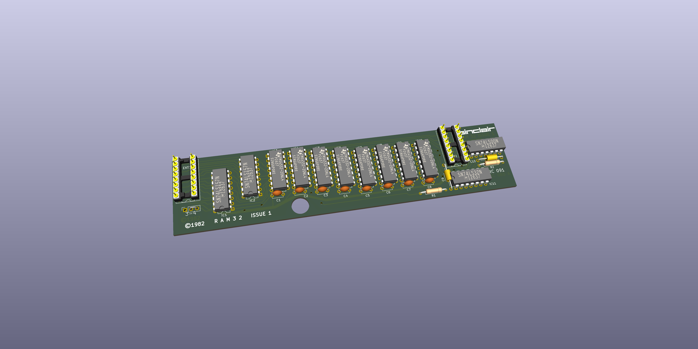

This is a Kicad 10 project and was only used to create an ibom to assist in the debugging of faulty boards. Use at your own risk.

Kicad does not like handrawn tracks, it only like straight lines so I have followed the route for each track but it does not track exactly but close enough for the user to find the track when debugging.

The ZX Spectrum Issue 1 32K RAM PCB used has an MFG date of 1982 and has a silkscreen FAB revision of SRC091, a topside FAB revision of SRC080 A and a solder side FAB revision of SRC097 B.

The created schematic was based on the physical layout of a raw PCB with known components. The resistor values were taken from a image of a populated PCB but it was impossible to determine the values of the capacitors used so I used the values from a ZX Spectrum Issue 2 schematic 32K Expansion for the smoothing caps (C3-C10). The values of C1 and C2 are also the values used in in the that schematic.

Note that the address lines A0 to A14 do not appear to route as expected but agree with the PCB tracking.

I would not use these gerbers to manufacture a PCB without a lot more checking.

Have fun.